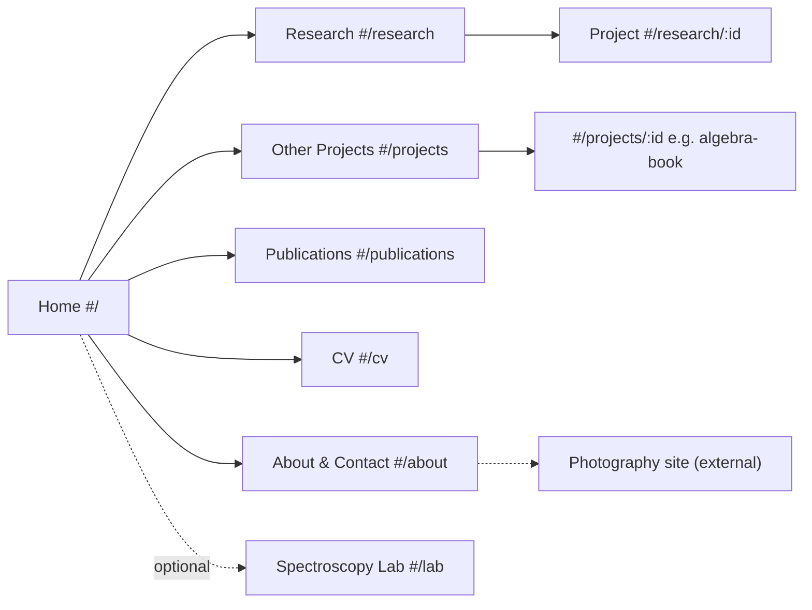
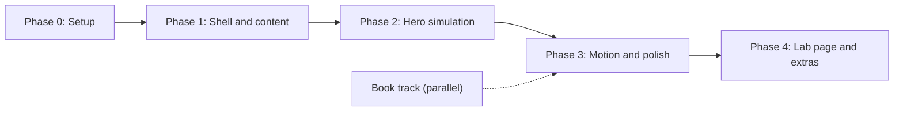

# Implementation Plan: Professional & Research Website
**Owner:** Erick Gatica Candia  
**Repo:** https://github.com/ErickGatica/Pro_website_ErickG (GitHub Pages)  
**Sister site:** Photography portfolio (`../Website`, repo `ErickGatica/Photos`)  
**Companion plan:** [ALGEBRA_BOOK_PLAN.md](ALGEBRA_BOOK_PLAN.md) (open textbook cleanup)  
**Status:** v2: decisions D1, D3, D5, D8 resolved (Nov 8, 2026). **Phases 0–3 implemented Nov 8, 2026** (see README). Deviations: equations hand-set in HTML instead of KaTeX; `tools/figures.json` instead of `figures.yaml`; `book/` source kept out of git (only the finished PDF will be published); book PDF download waits until third-party figures are replaced.

---

## 1. Goals

1. Present Erick as a **Ph.D. student in Mechanical Engineering (CU Boulder, Fulbright Scholar)** working on **laser absorption spectroscopy for combustion diagnostics**, moving into **spectroscopic databases** and **dual-comb spectroscopy**, with past experience in **wavelength modulation spectroscopy (WMS)**.
2. Show research projects with short descriptions, **figures from the papers**, and **full citations with DOI**. Make it easy to add new papers (the H₂-engine CO₂/H₂O sensor work).
3. Add an **Other Projects** section for teaching and side work. The first entry is the open algebra textbook *Complemento de Álgebra*.
4. Open with a **physics-based hero animation** in a **manim-inspired style**: a laser crosses a gas of molecules from left to right, and a live **H₂O spectrum near 1469 nm** responds to temperature, pressure and concentration.
5. Keep a **professional dark mode with bright, saturated accents** that stays simple, fast, and smooth on laptops and phones.

### Non-goals (v1)
- No backend, CMS, or build framework (static HTML/CSS/JS, same as the photo site).
- No 3D engine (decision D1 → **2D canvas**).
- No paper PDFs hosted on the site (D5). Figures and citations only.

---

## 2. What we reuse from the photography site

| Reuse as is (light edits) | Rework | New |
|---|---|---|
| `router.js` (hash routes + View Transitions) | `tokens.css` (manim-style palette, fonts) | `hero/` simulation (canvas + physics) |
| `nav.js` / `nav.css` (sliding indicator, mobile menu) | `home.js` (research-focused) | `research`, `projects`, `publications`, `cv` pages |
| `lightbox.js` / `lightbox.css` (paper figures, book pages) | `footer.js` (links incl. Photography) | `anim/` mini-library (draw-in, write, morph) |
| `utils.js`, `data.js` loader pattern | `about.js` / `contact.js` | `tools/` scripts (spectral data, figures, book) |

---

## 3. Information architecture



| Route | Content |
|---|---|
| `#/` **Home** | Hero simulation, headline and tagline, 3 research-focus tiles, featured project, latest publications, CTAs (CV PDF, LinkedIn, Photography) |
| `#/research` | Research project cards with status chips (**Current / Upcoming / Published**) and era filter (**Ph.D. · CU Boulder** / **M.Sc. & Chem. Eng. · USACH, Chile**) |
| `#/research/:id` | Summary, my role, key numbers, figure gallery (lightbox, each figure credited), **full citation + DOI** |
| `#/projects` **(new)** | Other projects: teaching material, open textbook, course papers, code. Cards with type chips (**Book · Teaching · Essay · Code**) |
| `#/projects/:id` | Detail page. For the algebra book: description, table of contents, page previews, **Download PDF** (own work, OK to share), license, changelog |
| `#/publications` | Full list grouped by year, formatted citation with DOI link, "Copy BibTeX" button, Erick's name highlighted |
| `#/cv` | **Full CV with descriptions**: experience and education timeline (with the bullet points from the CV), skills, teaching, volunteering, courses. **Download CV (PDF)** |
| `#/about` | Short bio with profile photo, contact **erick.gatica@colorado.edu**, LinkedIn, link to photography |
| `#/lab` *(optional, phase 4)* | Full-screen hero simulation with more controls and step-by-step manim-style explanation of the equations |

---

## 4. Content inventory (from `resources/`)

### 4.1 Headline and bio (draft)
> **Erick Gatica Candia**  
> Ph.D. Student in Mechanical Engineering · University of Colorado Boulder  
> *Laser absorption spectroscopy for cleaner combustion.*
>
> I build laser-based sensors that read temperature and gas composition straight from the light molecules absorb. In the Precision Laser Diagnostics Lab (Prof. Greg Rieker), I'm developing a CO₂/H₂O sensor for hydrogen combustion engines. I previously worked with wavelength modulation spectroscopy, and I'm now moving into dual-comb spectroscopy and high-temperature spectroscopic databases. Before Boulder, I studied Chemical Engineering in Chile (M.Sc., maximum distinction), working on solar energy storage, drying and desalination.

### 4.2 Profile photo
- Source: `resources/photos/Profile_photo.jpeg` (2016×2118, 2.3 MB).
- Export: square crop → `assets/img/profile-800.webp` and `profile-400.webp` (target < 80 KB), plus a 1200×630 `og-image.jpg` for link previews.
- Used on About, CV header and the home intro (circular frame with a thin laser-red/cyan gradient ring).

### 4.3 Research focus tiles (home)
1. **Combustion diagnostics:** real-time, in-situ laser sensors for H₂ and natural-gas engines.
2. **Spectroscopic databases** *(upcoming)*: accurate high-temperature absorption data for H₂O/CO₂.
3. **Techniques:** WMS → **dual-comb spectroscopy** *(upcoming)*.

### 4.4 Research projects

| id | Project | Era / status | Key facts for the card |
|---|---|---|---|
| `h2-engine-sensor` | Laser sensor for CO₂ & H₂O in hydrogen combustion engines | Ph.D. · **Current** | Main Ph.D. project; placeholder visuals; "publications forthcoming" |
| `dual-comb-databases` | Dual-comb spectroscopy & spectroscopic databases | Ph.D. · **Upcoming** | Short teaser; wording to confirm with Erick (D4) |
| `egr-sensor` | Compact, real-time EGR rate sensor for natural gas engines | Ph.D. collaborator · Published | Scanned-WMS on H₂O; **954 Hz** real-time with new *Integral Hashing* fitting; full sensor in **25×25×8 cm, 15 W**; within **2 % EGR** vs NDIR on a **250 kW 6-cyl** NG engine (0–25 % EGR); resolves transients NDIR can't |
| `firebrands` | High-speed thermal imaging of disk-shaped firebrands | Ph.D. collaborator · Published | **960 fps** color video; two-color pyrometry + particle tracking; 1.12 mm wooden disks; wind 0.4/1.1/2.0 m/s; temperature oscillations **50–480 Hz** correlated with relative speed |
| `solar-desalination` | Solar desalination with phase change materials | M.Sc. · Published | 0.55 m² passive solar still; coconut oil vs paraffin PCM; **1120–1313 L/m²/yr**; MATLAB model RMSE 0.03 kg / 1.9 °C |
| `solar-drying` | Solar sawdust drying in spouted beds with PCM storage (2 papers) | M.Sc. · Published | Exp.: 89 kg paraffin in 450 cans, 3 rectangular spouted beds in series, **27.6 %** moisture removed, ≥ 4 h on stored solar energy. Model: RTD + kinetics + micro-mixing, air T RMSE < 1.9 °C, moisture error < 5.6 % |

### 4.5 Citations (shown on cards, detail pages and `#/publications`)
Format: *Authors (Erick in bold), "Title," Journal Volume, Article (Year). doi:…* with the DOI as a link. Every figure caption ends with *"Reproduced from [short cite], doi:…"*.

1. C. S. Callahan, **E. Gatica**, S. C. Coburn, G. J. Hampson, G. B. Rieker, "Compact, real-time exhaust gas recirculation rate sensor for use in natural gas combustion engine control," *Proceedings of the Combustion Institute* 40, 105692 (2024). https://doi.org/10.1016/j.proci.2024.105692
2. C. Callahan, **E. Gatica**, S. Coburn, S. Simons-Wellin, L. Heinzen, L. Shannon, J. Farnsworth, P. E. Hamlington, G. B. Rieker, "High-speed thermal imaging of disk-shaped firebrands in a wind tunnel," *Fire Safety Journal* 162, 104707 (2026). https://doi.org/10.1016/j.firesaf.2026.104707
3. A. Reyes, **E. Gatica**, L. Henríquez-Vargas, N. Pailahueque, A. Vargas, "Experimental and numerical study of desalination using solar energy and phase change materials," *Journal of Environmental Chemical Engineering* 11, 111193 (2023). https://doi.org/10.1016/j.jece.2023.111193
4. A. Reyes, **E. Gatica**, L. Henríquez-Vargas, N. Pailahueque, "Modeling of sawdust drying in spouted beds using solar energy and phase change materials," *Journal of Energy Storage* 51, 104441 (2022). https://doi.org/10.1016/j.est.2022.104441
5. A. Reyes, **E. Gatica**, L. Henríquez-Vargas, N. Pailahueque, "Sawdust drying in a series of rectangular base spouted beds using solar energy," *Journal of Energy Storage* 48, 103881 (2022). https://doi.org/10.1016/j.est.2021.103881

`publications.json` stores structured fields (authors, title, journal, volume, article, year, doi). The display string and BibTeX are generated from them, so formatting stays consistent.

### 4.6 Paper figures
- **Share figures, never the PDFs.** Paper PDFs stay in `resources/`, which is git-ignored.
- Per paper: 1–3 figures (setup/schematic + key result), exported as **WebP ≤ 1600 px** plus a 600 px thumbnail, into `assets/figures/<project-id>/`.
- `tools/export_figures.py`: renders chosen PDF pages at 300 dpi (macOS PDFKit via JXA, or `pymupdf` if installed) and crops by coordinates in a small `figures.yaml`, so exports are reproducible.
- Optional dark-mode treatment: figures sit on a light "paper card" with rounded corners, since most journal figures have white backgrounds. Inverting them would distort colors and colormaps.

### 4.7 CV page content (from `CV_Erick_Gatica_in_English.pdf`)
Everything below goes into `src/data/cv.json` and renders as an animated timeline, with each entry showing its CV bullet points.

- **Summary:** Ph.D. researcher specializing in optical diagnostics, laser absorption sensors for H₂ and natural-gas combustion, thermal-fluid modeling, dual-comb spectroscopy.
- **Experience:** Graduate Research Assistant, CU Boulder (2023–present, PLD Lab, Dr. Greg Rieker); Research Assistant, USACH (2022–present, solar/PCM desalination); Adjunct Lecturer, U. Autónoma de Chile (2022–23, Process Control); University Instructor & TA, USACH (2020–present); Technical Editor, *Handbook of Chemical Reactor Design* (2022); Independent Consulting Engineer, Social Renewable (2021–22); FONDECYT Support Staff (2021–22); Intern, Maltexco-Patagonia Malt (2020); Fluid Mechanics Lab Assistant (2018–20); Differential Equations TA (2017–18); Lab Technician Intern, Eurofins GCL (2014–15).
- **Education:** Ph.D. Mechanical Engineering, CU Boulder (2023–2028, Fulbright; M.Sc. ME conferred May 2025); Fulbright Pre-Academic Program, Drexel (2023); M.Sc. Engineering Sciences, Chemical Engineering, USACH (2019–20, GPA 6.8/7.0, maximum distinction); Chemical Civil Engineer, USACH (2015–20, rank 1st).
- **Skills:** Python, C++, MATLAB, LaTeX; DAQ, signal analysis, embedded software; ANSYS Fluent, OpenFOAM, Aspen HYSYS; CFD, finite volumes, process simulation. **Languages:** Spanish (native), English (fluent, TOEFL iBT 94).
- **Leadership:** SOAR Board, ISSS CU Boulder (2026–present).
- **Courses:** Green Hydrogen (CORFO), CAE Fundamentals (iESSS), advanced graduate coursework, FONDECYT thesis, congress workshops.

### 4.8 Other Projects (new section)

| id | Project | Type | Notes |
|---|---|---|---|
| `algebra-book` | ***Complemento de Álgebra***: open textbook (Spanish) for engineering students at USACH: matrices, determinants, linear systems, vector spaces, linear transformations, 1st/2nd-order ODEs, Laplace transform | Book · Teaching | Cleaned up and re-typeset per [ALGEBRA_BOOK_PLAN.md](ALGEBRA_BOOK_PLAN.md). Free PDF download, page previews, chapter list, license |
| `algebra-slides` | Course introduction slides (beamer, *Introduction.tex*) | Teaching | Optional; same cleanup style as the book |
| `ligo-squeezing` | *Squeezing light and its role in gravitational-wave detection*: review essay (CU Boulder course with Prof. Scott Diddams) | Essay | Optional. Before publishing, fix: first detection was **Sept 2015** (GW150914), not 2014; write strain as 10⁻²¹; replace the `your@email.com` placeholder |
| *(future)* | Code: spectral fitting tools, DAQ utilities, etc. | Code | Add as repos become public |

### 4.9 Files in `resources/` that are **not** published
Third-party papers (`Goldenstein_2013`, `Cepstral_Kole_2019`, `High-temperature CO2 … Cole`, `2024_water_absorption…database`, `Combs_operation`, `Data availability … Ariel`) and Erick's own paper PDFs. They're used as background and as sources for figures only.

> [!IMPORTANT]
> `resources/` goes in `.gitignore`. Only processed outputs (WebP figures, CV PDF, the book PDF) are committed.

---

## 5. Visual identity: "manim-style" dark mode

The look is inspired by **manim** (the animation engine behind 3Blue1Brown and many science-outreach videos): pure dark background, bright saturated strokes, crisp math typography, and objects that **draw themselves in**, **morph**, and **label themselves**.

| Token | Value | Use |
|---|---|---|
| `--bg` | `#0b0c10` (near-black, slightly blue) | Page background |
| `--bg-grid` | `rgba(88,196,221,0.06)` | Faint coordinate grid behind hero and plots (manim `NumberPlane` feel) |
| `--surface` | `rgba(255,255,255,0.035)` + 1 px hairline border | Cards |
| `--text` / `--muted` | `#ece9e2` / `#8b93a1` | Body copy |
| `--blue` | `#58C4DD` | Spectrum traces, links, primary data |
| `--teal` | `#5CD0B3` | Secondary data, success, "Current" chip |
| `--yellow` | `#F7D96F` | Highlights, equation terms being changed |
| `--red` | `#FC6255` | Laser beam, primary accent, active nav |
| `--gold` | `#F0AC5F` | Temperature / flame cues |
| `--purple` | `#9A72AC` | Dual-comb mode, "Upcoming" chip |
| Fonts | **Inter** (UI), **Space Grotesk** (headings), **JetBrains Mono** (numbers/units), **KaTeX** (math) | |

### 5.1 Motion language
Implemented in a tiny local module `src/js/anim/` (~3 KB, no dependencies):

| manim idea | Web implementation | Where |
|---|---|---|
| `Create` (stroke draws in) | SVG/canvas `stroke-dashoffset` animation | Section dividers, plot axes, spectral line traces, card borders on hover |
| `Write` (text/equations appear stroke-by-stroke) | KaTeX-rendered equation, revealed with a left-to-right mask + glow | Hero equation $I/I_0 = e^{-\alpha(\nu)}$, research detail headers |
| `Indicate` / highlight | Scale 1.08 + yellow color pulse on a term | When a slider changes T, the *T* in the equation pulses yellow |
| `Transform` (morph) | Interpolate between two polylines/paths | Spectrum morphs smoothly between states instead of jumping |
| `smooth` rate function | `cubic-bezier(.45,0,.2,1)`-style easing everywhere | Global |
| Laser wipe | View Transitions API: a red line sweeps across during page change (fade fallback) | Route changes |

**Rules:** animate only `transform`, `opacity` and stroke offsets; respect `prefers-reduced-motion` (show the final state immediately); keep any single animation under 900 ms except the hero loop.

**KaTeX:** load only the math that's needed. Equations used on the site are **pre-rendered to HTML at build time** with `tools/render_math.mjs` (or lazy-loaded KaTeX ~75 KB gz on pages that need it). That avoids an extra runtime cost on the home page.

---

## 6. The hero simulation (core feature)

### 6.1 What the visitor sees

```
 ┌──────────────────────────────────────────────────────────────────┐
 │ · · · · · · · · · faint grid · · · · · · · · · · · · · · · · · · │
 │ laser ▸━━━━━━━━━━━━━[  H₂O   N₂   H₂O   H₂O  ]━━━━━━━━━━━▸ detector │
 │  (red stroke glow)      molecules flash when         dimmer beam │
 │                         a photon is absorbed                     │
 │  Erick Gatica                ┌─────────────────────────────────┐ │
 │  Laser spectroscopy for      │ α(ν)   T = 1200 K   P = 1 atm   │ │
 │  cleaner combustion          │  0.1┤      ╱╲                    │ │
 │                              │     │ ╱╲__╱  ╲___╱╲___           │ │
 │  I/I₀ = e^{-α(ν)}            │     └──────────────────── ν      │ │
 │  [Research] [CV]             │     1468.5   1469.5 nm           │ │
 │                              │ T ──●──   P ─●─   x ─●─          │ │
 │                              │ [Direct] [WMS-2f] [Dual-comb]   │ │
 └──────────────────────────────┴─────────────────────────────────┴─┘
```

- **Beam:** a red glowing stroke enters left, crosses the gas region and exits to a detector on the right. Its brightness fades along the path according to Beer–Lambert.
- **Molecules (2D, manim-style):** H₂O drawn as outlined circles (O in blue, H in white) connected by bright bonds at the true 104.5° angle. A few grey N₂ act as non-absorbing background. They drift and rotate in-plane with speeds set by temperature. On absorption, a molecule flashes yellow and plays a short vibration (symmetric stretch/bend wiggle).
- **Spectrum card:** axes draw in (`Create`), the trace morphs smoothly (`Transform`) when sliders move, peak absorbance is labeled live, and the equation term being changed is highlighted.
- **Controls:** Temperature (300–2000 K), Pressure (0.2–5 atm), H₂O mole fraction (1–30 %), mode tabs. Mobile shows the spectrum and the temperature slider only, with the others in a "More" drawer.

### 6.2 Spectral window: H₂O near 1469 nm (D3 resolved)
- Window: **~6800–6815 cm⁻¹ (≈ 1467.4–1470.6 nm)**, in the ν₁+ν₃ combination band of water.
- This region includes the well-known **~6806 cm⁻¹ (1469.3 nm)** H₂O transition, which has a high lower-state energy. That's why it's popular for high-temperature thermometry: its strength *grows* with temperature while nearby low-E″ lines fade. This gives a striking, physically correct reaction to the temperature slider.
- **Target absorbance ≈ 0.1:** the build script picks a default path length *L* so that peak absorbance stays around **0.05–0.15 for 600–1500 K** at x = 10 %, P = 1 atm. The exact *L* is printed by the script and stored in `spectra.json`.
- Final line list and default *L* are verified against HITRAN/HAPI (see §6.4).

### 6.3 Real physics (computed in the browser)

**Line strength vs temperature**

$$
S_j(T) = S_j(T_0)\,\frac{Q(T_0)}{Q(T)}\,
\exp\!\left[-c_2E''_j\left(\frac{1}{T}-\frac{1}{T_0}\right)\right]
\frac{1-\exp(-c_2\nu_j/T)}{1-\exp(-c_2\nu_j/T_0)}
$$

**Broadening**
- Doppler HWHM: $\gamma_D = \dfrac{\nu_j}{c}\sqrt{\dfrac{2\ln 2\,k_BT}{m}}$
- Collisional HWHM: $\gamma_L = P\left[x\,\gamma_{\text{self}} + (1-x)\,\gamma_{\text{air}}\right]\left(\dfrac{T_0}{T}\right)^{n}$
- Line shape: **pseudo-Voigt** (Thompson–Cox–Hastings), about 1 % accurate and cheap enough for real time.

**Absorbance & transmission**

$$
\alpha(\nu) = \sum_j S_j(T)\,\phi_j(\nu)\,\frac{x\,P}{k_BT}\,L,
\qquad \frac{I}{I_0} = e^{-\alpha(\nu)}
$$

**Modes**
- **Direct absorption:** plot $\alpha(\nu)$ (default) or $I/I_0$.
- **WMS-2f:** simulate $\nu(t)=\bar\nu + a\cos\omega t$ with linear intensity modulation, then lock-in project the transmitted signal onto $1\omega$ and $2\omega$ for each $\bar\nu$. Plot the **2f/1f** signal, as in the EGR-sensor work. The modulation depth *a* has its own slider (optimum near 2.2 × HWHM).
- **Dual-comb:** two combs with slightly different repetition rates (purple and blue tick marks). Each tooth samples the transmission, and the RF beat comb underneath shows the same spectrum compressed into radio frequencies. Scales are illustrative, but the optical → RF mapping is correct.

**What the visitor sees when T rises** (all physically correct):
1. The 6806 cm⁻¹ high-E″ line grows while low-E″ lines fade (two-line thermometry, made visible).
2. Doppler width grows ∝ √T, collisional width shrinks ∝ T⁻ⁿ.
3. Number density drops at constant P (fewer molecules on screen, lower overall absorbance).
4. Molecules move and spin faster (speeds sampled from Maxwell–Boltzmann, ∝ √(T/m)).
5. Background tint shifts from cool blue toward gold (aesthetic only).

### 6.4 Data pipeline (offline, once)
`tools/build_spectral_data.py` (Python + HITRAN `hapi`, needs internet once):
1. Fetch H₂O lines for 6795–6820 cm⁻¹ (padding for line wings).
2. Keep lines that reach ≥ 1 % of the window's peak strength anywhere in 300–2000 K (expected ~30–80 lines, so tiny data).
3. Tabulate the partition function Q(T) every 25 K (200–2500 K).
4. Choose the default *L* for the ~0.1 peak absorbance target.
5. Write `src/data/spectra.json` (< 10 KB) and reference arrays for testing.

`tests/physics.test.html` checks the JS output against `hapi`'s `absorptionCoefficient_Voigt` at 300, 1000 and 1800 K. Pass threshold: within 2 %.

### 6.5 Rendering (D1 resolved: 2D canvas)
- One `<canvas>` for the scene (grid, beam, molecules), plus one `<canvas>` for the plot inside the card. UI controls are HTML.
- Glow: draw strokes twice (wide low-alpha + thin bright), with additive blending (`globalCompositeOperation = "lighter"`). This gives the manim look without WebGL.
- Molecule sprites are pre-rendered to offscreen canvases per color/scale, so each frame is just cheap `drawImage` calls.

### 6.6 Performance budget & safeguards
- Physics recomputes **only on slider change** (rAF-throttled). 600-point grid × ≤ 80 lines is microseconds of work.
- 60 fps desktop / 30 fps mobile; `devicePixelRatio` capped at 2.
- Molecule count adapts: desktop ~36, mobile ~14, halved automatically if frame time > 20 ms.
- Pauses when offscreen (IntersectionObserver) or when the tab is hidden.
- `prefers-reduced-motion` → static scene + still-interactive spectrum.
- No-JS fallback: a static poster `assets/img/hero-poster.webp`.
- Targets: **Lighthouse mobile ≥ 90 performance, ≥ 95 accessibility**, JS < 50 KB gz, LCP < 2.0 s.

---

## 7. Project structure

```
Website_professional/
├── index.html
├── .nojekyll
├── .gitignore                 # resources/, .DS_Store, __pycache__/, book/build/
├── README.md
├── plan/
│   ├── IMPLEMENTATION_PLAN.md
│   └── ALGEBRA_BOOK_PLAN.md
├── assets/
│   ├── docs/CV_Erick_Gatica.pdf
│   ├── docs/Complemento_de_Algebra.pdf      # built from book/
│   ├── img/ (profile-400/800.webp, hero-poster.webp, og-image.jpg)
│   ├── figures/<project-id>/{full,thumb}/*.webp
│   └── book/previews/*.webp                 # page previews
├── book/                                    # cleaned LaTeX source (see book plan)
├── src/
│   ├── css/  tokens.css, base.css, components/{nav,hero,cards,timeline,research,projects,lightbox,pages}.css
│   ├── js/
│   │   ├── main.js, router.js, config.js, data.js, utils.js
│   │   ├── anim/{create,write,transform,easing}.js
│   │   ├── components/{nav,footer,lightbox,reveal,citation}.js
│   │   ├── pages/{home,research,research-detail,projects,project-detail,publications,cv,about,lab}.js
│   │   └── hero/{hero,physics,molecules,beam,plot}.js
│   └── data/
│       ├── projects.json       # research projects   ← edit to add research
│       ├── other-projects.json # book, essays, code  ← edit to add side projects
│       ├── publications.json   # ← edit to add papers (DOI required)
│       ├── cv.json
│       └── spectra.json        # generated
├── tools/
│   ├── build_spectral_data.py
│   ├── export_figures.py + figures.yaml
│   └── render_math.mjs (optional)
├── tests/physics.test.html
└── .github/workflows/
    ├── pages.yml               # deploy site
    └── book.yml                # compile LaTeX book → PDF (see book plan)
```

**Adding a new paper later:** add one entry to `publications.json` (with DOI), link it from a project in `projects.json`, add figure crops to `figures.yaml`, run `tools/export_figures.py`, then commit.

---

## 8. Phased roadmap



| Phase | Deliverables | Done when |
|---|---|---|
| **0 · Setup** (½ day) | `git init`, remote `Pro_website_ErickG`, `.gitignore`, `.nojekyll`, copy shell from photo site, manim tokens, profile photo export | Themed blank site live on GitHub Pages |
| **1 · Shell & content** (2 days) | Nav, router; Home (static hero placeholder); Research list + detail with citations; Other Projects list + detail; Publications; full CV page; About; figure export script and first figures | All pages navigable on desktop and phone; Erick has proofread the content |
| **2 · Hero simulation** (3–4 days) | `spectra.json` pipeline (1469 nm H₂O); `physics.js` + tests; 2D molecule and beam renderer; spectrum card; Direct, then WMS-2f, then Dual-comb | Physics within 2 % of HAPI; 60 fps laptop / 30 fps mid-range phone |
| **3 · Motion & polish** (2 days) | `anim/` module (Create/Write/Transform/Indicate), laser-wipe transitions, KaTeX equations, lightbox, reduced-motion paths, SEO/OG, favicon | Lighthouse mobile ≥ 90 / ≥ 95 a11y |
| **4 · Extras** (optional) | `#/lab` explainer; LIGO essay page; Spanish toggle; custom domain | |
| **Book track** (parallel, see book plan) | Cleaned LaTeX book, CI-built PDF, previews | PDF linked from `#/projects/algebra-book` |

---

## 9. Testing & verification
- **Physics:** compare against HAPI reference arrays (3 T × 2 P); WMS-2f symmetric for an isolated line; dual-comb RF amplitudes equal the sampled transmission.
- **Citations:** script checks every `publications.json` DOI resolves (HTTP 200/302) and that each figure caption has a citation.
- **Devices:** Chrome/Safari/Firefox desktop; iPhone Safari; Android Chrome; portrait and landscape.
- **Performance:** Lighthouse mobile; Performance panel frame time with 4× CPU throttle.
- **Accessibility:** keyboard navigation, focus rings, slider `aria-valuetext` ("Temperature 1200 kelvin"), contrast ≥ 4.5:1 for text (bright accents only on large elements or strokes), canvas text alternative.

---

## 10. Decisions

| # | Decision | Status |
|---|---|---|
| D1 | Rendering | ✅ **2D canvas, manim-style** |
| D2 | Hero modes on mobile | Proposed: Direct + T slider on mobile; all modes on desktop |
| D3 | Spectral window | ✅ **H₂O near 1469 nm, peak absorbance ≈ 0.1** |
| D4 | Public wording for current/upcoming work | ⏳ Confirm with Dr. Rieker |
| D5 | Paper material | ✅ **Figures only, with full citation + DOI; no PDFs** |
| D6 | Profile photo | ✅ `resources/photos/Profile_photo.jpeg` |
| D7 | Language | Proposed: English site; the book stays in Spanish |
| D8 | Contact email | ✅ **erick.gatica@colorado.edu** |
| D9 | Custom domain | Later (Phase 4) |
| D10 | Publish LIGO essay? | ⏳ Optional, after the fixes in §4.8 |

---

## 11. Next step
Start **Phase 0 + Phase 1** (shell, real content, CV, research, publications, other projects) in parallel with the **book cleanup track**. Then build the hero simulation (Phase 2).
